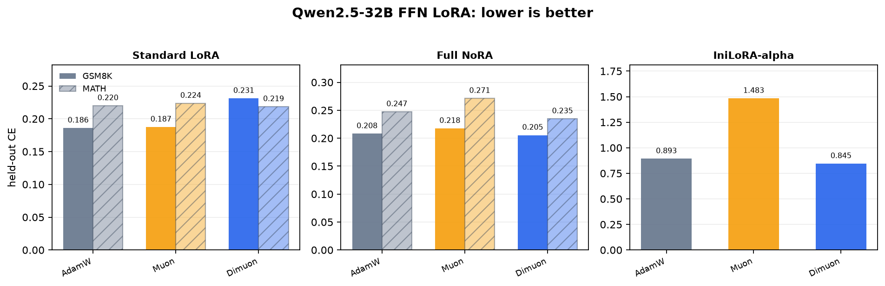
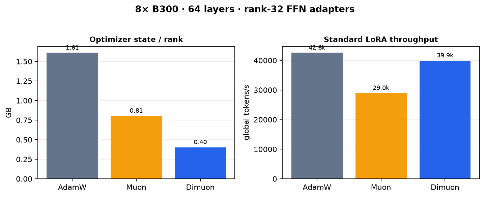

# Dimuon for FFN LoRA fine-tuning

A compact reproduction of the Dimuon optimizer comparison on a **32B** language model using **all 8 B300 GPUs**. The base model is frozen; only rank-32 LoRA factors on the `gate_proj`, `up_proj`, and `down_proj` FFN projections in all 64 Qwen2.5-32B layers are trained.

> The headline result is a promising SFT/NoRA pilot. The short RL pilots are included for plumbing validation and do not establish an RL optimizer win.

## Headline results

Held-out teacher-forced CE, lower is better. Each row uses the same model, token stream, seed, batch shape, and update budget for all three optimizers.

| Parameterization / task | AdamW | Muon | Dimuon |
| --- | ---: | ---: | ---: |
| Standard LoRA / GSM8K | 0.1859 | 0.1874 | **0.1812** |
| Standard LoRA / MATH | 0.2200 | 0.2236 | **0.2185** |
| Full NoRA / GSM8K | 0.2080 | 0.2175 | **0.2054** |
| Full NoRA / MATH | 0.2473 | 0.2712 | **0.2347** |
| IniLoRA-alpha / GSM8K* | 0.8925 | 1.4832 | **0.8447** |

`*`IniLoRA-alpha uses a 20-update panel and BF16 residual subtraction changes the effective starting point; compare it only within that panel.



For standard LoRA, the optimizer state per replicated rank was 1.61 GB for AdamW, 0.81 GB for Muon, and 0.40 GB for Dimuon. Standard-LoRA throughput averaged across GSM8K/MATH was 42.6k, 29.0k, and 39.9k global tokens/s respectively.



| Optimizer | State / rank | Standard-LoRA global tok/s* |
| --- | ---: | ---: |
| AdamW | 1.61 GB | 42.6k |
| Muon | 0.81 GB | 29.0k |
| Dimuon | 0.40 GB | 39.9k |

`*`Mean of the clean 50-update GSM8K and MATH SFT runs; throughput is workload-specific, not a universal hardware peak.

## RL status

The repository also contains a real synchronous REINFORCE loop: sample completions, score answers, recompute sampled sequence log-probabilities, and apply the optimizer update. The 32B pilots used 8 GPUs, all 64 FFN layers, 16 updates, and 128 training rollouts per optimizer.

| Task | AdamW reward / exact | Muon reward / exact | Dimuon reward / exact |
| --- | --- | --- | --- |
| GSM8K | 0.0729 / 0% | 0.0736 / 12.5% | 0.0624 / 6.25% |
| MATH | 0.0977 / 6.25% | 0.0748 / 12.5% | 0.0661 / 6.25% |

These are one-seed diagnostic pilots with a 16-question held-out set and bounded numeric shaping. They do not support a claim that Dimuon outperforms on RL.

## Reproduce

The scripts expect a local model and the pinned question-only manifests. The commands below are the exact SFT workload shape used for the headline tables:

```bash
MODEL=/path/to/Qwen2.5-32B-Instruct
DATA=/path/to/manifests

CUDA_VISIBLE_DEVICES=0,1,2,3,4,5,6,7 \
torchrun --standalone --nproc_per_node=8 dimuon_lora_benchmark.py \
  --model "$MODEL" \
  --manifest "$DATA/gsm8k_train.jsonl" \
  --eval-manifest "$DATA/gsm8k_val.jsonl" \
  --method all --init lora --steps 50 --warmup 10 \
  --batch 2 --seq 512 --rank 32 --last-n 64 \
  --adamw-lr 1e-4 --muon-lr 1e-3 --dimuon-lr 1.2e-2 \
  --grouped-dimuon --out results/my_gsm8k.json
```

Use `--manifest "$DATA/math_train.jsonl"` and `--eval-manifest "$DATA/math_val.jsonl"` for MATH. Use `--init nora` for full NoRA (continuous A normalization), `--init nora_init` for one-time NoRA-init, and `--init inilora_alpha` for IniLoRA-alpha.

Generate the README plots from committed JSON files with:

```bash
python make_figures.py
```

The optimizer implementation is in [`dimuon.py`](dimuon.py); the SFT harness is [`dimuon_lora_benchmark.py`](dimuon_lora_benchmark.py); the policy-gradient diagnostic is [`dimuon_lora_rl.py`](dimuon_lora_rl.py).

## Scope and limitations

- The measured checkpoint is Qwen2.5-32B-Instruct, not DeepSeek-V4.1. The available local DeepSeek-V4.1-Flash implementation is inference-only and cannot provide a valid autograd training run.
- These SFT runs are short (50 updates for standard LoRA, 20 for NoRA/IniLoRA-alpha), single-seed studies. They demonstrate a reproducible engineering result, not a universal optimizer ranking.
- The RL runs are intentionally labeled diagnostic: exact rewards are sparse, MATH includes symbolic answers, and the reward shaping is not a canonical GSM8K/MATH objective. Multi-seed, larger-rollout RL is still needed.
- No model weights, datasets, checkpoints, or large logs are committed. See [`BENCHMARK_DETAILS.md`](BENCHMARK_DETAILS.md) for the complete protocol, tables, learning rates, and caveats.
